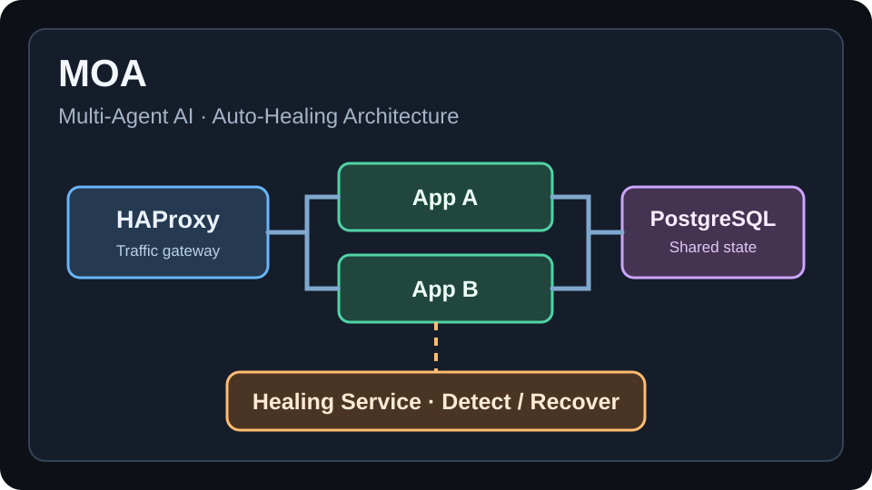

# Jihun Rho

### CUDA & GPU Performance Engineer · Computer Vision

**Building high-throughput vision systems, from CUDA kernels to real-time applications.**

Seoul, South Korea · Open to remote opportunities

---

## About me

My work spans **GPU performance engineering, computer vision, and real-time systems**. I have **4 years 8 months of hands-on CUDA/C++ experience** optimizing industrial machine-vision workloads, alongside research experience in vision and software work integrating robotics and sensors.

I focus on profiling-driven optimization: identifying pipeline bottlenecks, choosing what belongs on the CPU or GPU, and tuning kernels, memory use, and execution overlap. In production, this work contributed to **11.2× throughput over a single-core CPU baseline**, **~40% over a multi-core CPU-only pipeline**, and throughput of **2.52 million images per hour**.

Currently completing a full-time AI Orchestration program while building end-to-end vision and inference systems.

## Featured Project

### High-Throughput CUDA Vision Pipeline
Production machine-vision work for pharmaceutical inspection. I optimized the CPU–GPU processing pipeline through selective CUDA acceleration, workload allocation, kernel and memory tuning, and NVIDIA Nsight profiling. Proprietary algorithms and implementation details are not disclosed.

For the full overview of my work, visit [**931njhthe-star.github.io**](https://931njhthe-star.github.io/en/). &#x20;

**Tech stack:** `C++` · `CUDA` · `Nsight Systems` · `Nsight Compute` · `Computer Vision`

## More Projects

<table>
<tr>
<td width="50%" valign="top">

### DriveFusion — Real-Time Camera–Radar Perception & Evaluation

A solo CARLA project combining YOLO11n detection, vehicle tracking, radar-assisted distance estimation, and a Qt monitoring dashboard. A C++/CUDA TensorRT module runs inference; session recording and ground-truth evaluation support repeatable comparisons across nine driving sessions.

**Evaluation:** 16,491 common samples, **5.41% lower overall distance MAE**; 437 radar-corrected samples, **39.42% lower MAE**.

**C++ · CUDA · TensorRT · YOLO11n · Qt · CARLA · Radar fusion**

[Project page](https://931njhthe-star.github.io/en/drivefusion/) · [Repository](https://github.com/931njhthe-star/DriveFusion)

</td>
<td width="50%" valign="top">

### DriveFusion Incident Review · LLM-Assisted Collision Analysis

A local dashboard pairs selected collision frames with aligned vehicle and sensor records, then caches an evidence-based LLM summary with the session.

[Project page](https://931njhthe-star.github.io/en/drivefusion/accident-review/)

</td>
</tr>
</table>

<table>
<tr>
<td width="100%" valign="top">

### Robotics & 3D Bin-Picking System Integration

At INA Oriental Motor, integrated a MiR autonomous mobile robot, a Doosan six-axis robot, Solomon 3D vision, and pneumatic gripper control into a coordinated demonstration system. Developed software interfaces for existing device controllers and coordinated robot, vision, and gripper workflows.

**Python · REST · TCP/IP · Modbus · Digital I/O · 3D vision**

[Project page](https://931njhthe-star.github.io/en/robotics-vision/)

</td>
</tr>
</table>

<table>
<tr>
<td width="33%" valign="top">

### SubSync — AI-Powered YouTube English Tutor

Led a five-person team building a Chrome extension MVP for learning English with synchronized subtitles, saved vocabulary, and an AI tutor. Integrated the extension with backend APIs, authentication, storage, and caching. The backend test suite passed all 79 tests.

**Chrome Extension (MV3) · FastAPI · AI agent · Supabase · Redis**

[Repository](https://github.com/931njhthe-star/subsync-ai-tutor)

</td>
<td width="33%" valign="top">

### [CareerLens — AI Resume & Job Matching](https://github.com/931njhthe-star/CareerLens-fullstack)

An AI-powered resume and job matching platform using LangGraph parallel evaluation. Designed the AI architecture, database integration, and deployment workflow.

**Python · LangGraph · FastAPI · PostgreSQL**

[Repository](https://github.com/931njhthe-star/CareerLens-fullstack)

</td>
<td width="33%" valign="top">

### MOA — Multi-Agent AI System & Auto-Healing

A team-developed AI service designed for resilient operation. Worked on automated failure detection and recovery, including gateway failover, interpreter fallback, container restart, and checkpoint-based task resumption.

**Python · FastAPI · Docker · HAProxy · PostgreSQL · AI Agents**

[Repository](https://github.com/poohoot-ai/2026_aio2_moa)

</td>
</tr>
<tr>
<td width="33%" valign="top">

### <a href="https://speakup-seven.vercel.app/">Speak Up — English Academy Website</a>

**Currently in active use by an English conversation academy.** I designed, built, and deployed the website, which presents the academy’s classes and learning programs, student testimonials, schedule, directions, and consultation links.

**React · TypeScript · Vite · Tailwind CSS · Vercel**

[Visit Live Website](https://speakup-seven.vercel.app/)

</td>
<td width="33%"></td>
<td width="33%"></td>
</tr>
</table>

## Technical skills

| Area | Skills and tools |
|---|---|
| **GPU performance** | C++, CUDA kernels, memory tuning, stream overlap, occupancy, CPU–GPU pipeline optimization |
| **Profiling** | NVIDIA Nsight Systems, NVIDIA Nsight Compute, performance analysis |
| **Computer vision** | OpenCV, image processing, detection, tracking, calibration, camera–radar fusion |
| **Inference** | TensorRT, YOLO, real-time evaluation |
| **Systems** | Multithreading, Qt, CMake, Windows, Linux |
| **Robotics & integration** | Robot control, REST, TCP/IP, Modbus, Digital I/O |
| **AI application engineering** | Python, FastAPI, LangGraph, Docker, CI/CD |

For the full overview of my work, visit [**931njhthe-star.github.io**](https://931njhthe-star.github.io/en/). &#x20;
---

GPU performance · Real-time vision · High-throughput systems

